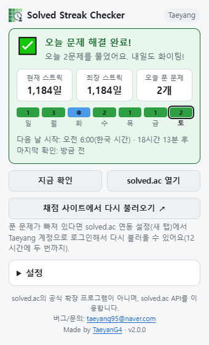
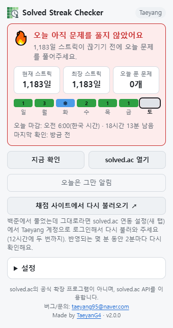
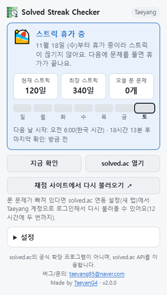
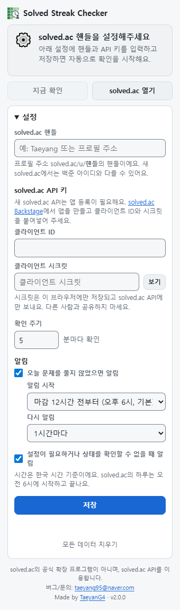
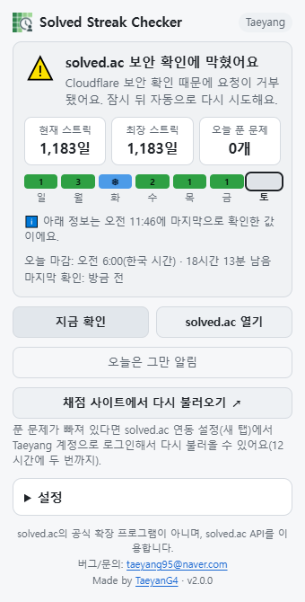
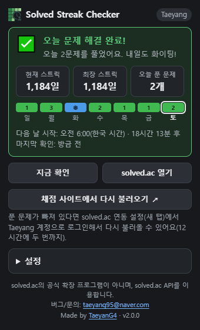

# Solved Streak Checker (솔브드 스트릭 체커)

[](https://developer.chrome.com/docs/extensions/) [](LICENSE)

solved.ac 스트릭(잔디)을 백그라운드에서 자동으로 확인하고, **오늘 문제를 아직 풀지 않았다면 마감(오전 6시, 한국 시간) 전에 데스크톱 알림**으로 알려주는 Chrome 확장 프로그램입니다.

> 이 확장 프로그램은 solved.ac의 공식 앱이 아니며, solved.ac가 제공하는 [공식 API](https://backstage.solved.ac/developer/docs)를 이용합니다.

> **v2.0 — 새 solved.ac 대응**
> 백준 재오픈과 함께 solved.ac가 새로 바뀌면서 프로필 주소(`/profile/…` → `/u/…`), 페이지 구조, 계정 체계(solved.ac 핸들 ≠ 백준 아이디)가 달라졌고,
> 2026년 11월 17일부터 **공식 API(v4)** 가 공개되었습니다(구 API v3는 지원 종료). 공식 API는 **모든 요청에 앱 자격 증명(클라이언트 ID/시크릿)** 을 요구합니다.
> v2.0은 확장 프로그램을 처음부터 다시 만들어, 페이지를 긁어오는 대신 공식 API로 스트릭을 확인합니다. 더 이상 프로필 페이지를 방문하지 않아도 됩니다.

---

**목차**

* [주요 기능](#주요-기능)
* [스크린샷](#스크린샷)
* [설치 방법](#설치-방법)
* [사용 방법](#사용-방법) — [API 키 발급](#1-solvedac-api-키-발급)
* [작동 방식](#작동-방식)
* [권한과 개인정보](#권한과-개인정보)
* [개발](#개발)
* [알려진 한계](#알려진-한계)
* [변경 기록](#변경-기록)
* [라이선스](#라이선스) / [연락처](#연락처)

---

## 주요 기능

* **자동 확인** — 설정한 주기(기본 5분)마다 solved.ac 공식 API로 오늘 문제를 풀었는지 확인합니다. 프로필 페이지를 열어둘 필요가 없습니다.
* **정확한 하루 기준** — solved.ac의 하루(오전 6시 KST 시작)를 그대로 따르고, 서버 시계와의 차이를 보정합니다. 오전 6시가 지나면 바로 새 날 상태로 다시 확인합니다.
* **한눈에 보는 상태** — 툴바 배지: `✓` 오늘 해결 · `!` 아직 안 풂 · `휴` 스트릭 휴가 중 · `?` 확인 불가 · `…` 설정 필요
* **팝업** — 현재/최장 스트릭, 오늘 푼 문제 수, 최근 7일 기록(스트릭 프리즈 사용일 포함), 마감까지 남은 시간, 마지막 확인 시각. 라이트/다크 모드.
* **똑똑한 알림**
  * 오늘 안 풀었으면 알림. 마감 3시간 전부터는 "스트릭이 끊기기 직전" 문구로 바뀝니다.
  * **알림 시작 시각**(기본: 마감 12시간 전인 오후 6시부터 / 하루 종일 / 마감 6·3·1시간 전부터)과 **다시 알림 간격**(하루 한 번 / 10분 ~ 3시간)을 고를 수 있고, 확인 주기와 따로 그 시각에 맞춰 알람을 예약합니다(Chrome·운영체제 사정으로 조금 늦을 수 있습니다).
  * 새 알림은 방금(2분 안에) solved.ac에서 확인한 정보로만 띄웁니다. 그 확인이 실패했을 때만 마지막 정보(최대 20분 전)로 알리며, 알림에 "최근 확인 실패 · 시각 기준"이라고 표시합니다 — 그 사이 다른 기기에서 풀었다면 이 알림은 틀릴 수 있습니다.
  * 오류 때문에 확장이 미해결 알림을 닫았다면, 상태가 돌아왔을 때 다시 띄웁니다("하루 한 번만"이어도). 사용자가 직접 닫은 알림은 정한 간격 전에는 다시 띄우지 않습니다.
  * 알림의 **"오늘은 그만 알림"** 버튼으로 그날 알림 끄기.
  * 문제를 풀면 알림이 자동으로 사라지고, 스트릭 휴가 중에는 알리지 않습니다.
  * 확인이 계속 실패하면(선택) 원인과 해결 방법을 알려줍니다. 같은 원인은 하루 한 번, "설정이 필요해요"는 한 번만 알리고, 절전 복귀 직후 같은 일시적인 네트워크 오류로는 알리지 않습니다.
* **채점 사이트에서 다시 불러오기** — 백준에서 푼 문제가 solved.ac에 반영되지 않았으면(아직 안 풀었다고 나오거나 문제 수·최근 기록이 빠짐), 팝업의 **채점 사이트에서 다시 불러오기 ↗**가 solved.ac의 [연동 설정](https://solved.ac/settings/integrations)을 새 탭으로 엽니다. 거기서 solved.ac에 로그인한 채로 **채점 사이트에서 다시 불러오기**를 누르면(solved.ac 안내: 12시간에 두 번까지, 차이가 있는 문제는 몇 분 안에 반영) 확장은 그동안(10분) 2분마다 다시 확인하고, 확인 결과(오늘 해결 여부·문제 수·스트릭·최근 7일)가 누를 때와 달라지면 멈춥니다(요청 제한 대기·백오프 중에는 그것이 끝난 뒤에 확인). 다시 불러오기 자체는 solved.ac가 앱에 맡기지 않는 기능이라 확장이 대신 누르지 않습니다.
* **쉬운 설정** — 핸들 자리에 프로필 주소(`https://solved.ac/u/핸들`)를 붙여넣어도 됩니다. 저장할 때 사용자와 API 키를 실제로 확인합니다(요청 제한으로 기다리는 중이면 확인을 미루고 저장한 뒤, 대기가 끝나는 즉시 새 키로 확인합니다). 팝업은 바꾼 항목만 저장하므로 다른 기기에서 바꾼 설정을 덮어쓰지 않고, 폼을 연 뒤나 확인하는 사이에 다른 곳(다른 기기·탭)에서 핸들이나 키가 바뀌었으면 저장하지 않고 알려줍니다. 저장하는 동안에는 폼이 잠깁니다.
* **v1 사용자 배려** — 이전 버전의 주기/알림 설정을 그대로 이어서 쓰고(v2에서 직접 바꾼 항목만 v2 값을 씀), 예전 아이디는 확인용 제안값으로만 채워 둡니다(새 solved.ac 핸들이 다를 수 있어서). **이 아이디가 맞아요**를 누르거나 핸들을 직접 입력해야 핸들로 쓰며, 알림 설정만 바꿔 저장할 때는 제안값을 쓰지 않습니다. 동기화된 v1 설정은 아직 업데이트하지 않은 다른 기기를 위해 남겨 둡니다.
* **모든 데이터 지우기** — 설정의 버튼 하나로 동기화된 설정과 이 기기의 키·기록을 모두 지웁니다. 동기화된 설정이 지워지므로 같은 Google 계정의 다른 기기에서도 핸들이 사라집니다(그 기기에는 키와 기록이 남아 있으니 필요하면 거기서도 지우세요). 단 하나의 예외로, solved.ac가 정한 요청 제한(429) 대기가 남아 있으면 **어느 키였는지 없이 남은 대기 기록들(받은 시각·서버 시각·대기 길이·시계 보정량·마지막으로 확인한 시각)만** 남기고, 각 대기가 끝나면 지웁니다(그동안은 새로 입력한 키로도 확인을 미룹니다).

## 스크린샷

| 오늘 해결 | 아직 안 풂 | 스트릭 휴가 |
|:---:|:---:|:---:|
|  |  |  |

| 처음 설정 | 확인 불가(마지막 정보 유지) | 다크 모드 |
|:---:|:---:|:---:|
|  |  |  |

> 스크린샷은 E2E 테스트(`python -I tests/e2e/run_e2e.py --screenshots`)가 가짜 데이터로 자동 생성합니다.

---

## 설치 방법

### 수동 설치 (개발자 모드)

1. 이 저장소를 내려받습니다. (`Code` → `Download ZIP` 후 압축 해제, 또는 `git clone https://github.com/TaeyanG4/Solved-Streak-Checker.git`)
2. Chrome 주소창에 `chrome://extensions`를 입력합니다.
3. 오른쪽 위 **개발자 모드**를 켭니다.
4. **압축해제된 확장 프로그램을 로드합니다**를 누르고, `manifest.json`이 있는 폴더를 선택합니다.

Chrome 116 이상이 필요합니다.

### v1에서 업데이트하기

1. 기존 폴더의 파일을 새 버전으로 바꾸고(또는 `git pull`), `chrome://extensions`에서 **새로고침(⟳)** 합니다.
2. "새 solved.ac에 맞춰 다시 설정해주세요" 알림/팝업이 나타납니다. 핸들 칸에는 예전 아이디가 채워져 있는데, **새 solved.ac 핸들이 맞는지 꼭 확인**하세요. (예: 백준 `myboj2024` → solved.ac `MyHandle`. 같은 문자열이 다른 사람의 핸들일 수도 있습니다.)
3. 아래 방법으로 API 키를 받아 입력하고 저장하면 다시 추적을 시작합니다. 확인 주기와 알림 설정은 그대로 옮겨집니다.

---

## 사용 방법

### 1. solved.ac API 키 발급

solved.ac 공식 API는 모든 요청에 **앱의 클라이언트 ID와 시크릿**이 필요합니다. 공개 배포되는 확장 프로그램에 시크릿을 넣어 둘 수는 없으므로([개발자 약관](https://solved.ac/developer-terms) 제4조), 각자 앱을 하나 만들어 사용합니다. 무료입니다.

1. [solved.ac Backstage → 앱](https://backstage.solved.ac/developer/apps)에 solved.ac 계정으로 로그인합니다.
2. 새 앱을 만듭니다(이름 예: `My Streak Checker`). 이 확장 프로그램은 공개 정보만 읽으므로 OAuth 리디렉트나 추가 권한은 필요 없습니다.
3. 발급된 **클라이언트 ID**와 **시크릿**을 복사합니다. 시크릿은 다른 사람과 공유하지 마세요.

### 2. 확장 프로그램 설정

1. 설치하면 설정 탭이 자동으로 열립니다. 나중에는 툴바 아이콘 → **설정**, 또는 `chrome://extensions` → 세부정보 → **확장 프로그램 옵션**으로 엽니다. 툴바 팝업은 다른 창을 누르면 닫히므로, 키를 복사해 올 때는 **새 탭에서 설정하기** 버튼을 쓰세요.
2. **solved.ac 핸들**: 내 프로필 주소 `https://solved.ac/u/핸들`의 **핸들**. 주소를 통째로 붙여넣어도 됩니다. 새 solved.ac에서는 핸들이 **백준 아이디와 다를 수 있습니다.**
3. **클라이언트 ID / 시크릿**: 위에서 받은 값을 붙여넣습니다. 클라이언트 ID는 고칠 수 있게 그대로 보여주지만, 한 번 저장한 시크릿은 다시 보여주지 않으며 바꿀 때만 새로 입력하면 됩니다. 아직 키가 없다면 알림 설정(과 핸들)만 먼저 저장할 수도 있습니다.
4. 필요하면 확인 주기와 알림 옵션을 고르고 **저장**합니다. 저장하면 바로 확인을 시작합니다.

| 설정 | 설명 | 기본값 |
|---|---|---|
| 확인 주기 | solved.ac를 확인하는 간격(1~1440분). 오늘 이미 풀었거나 휴가 중이면 30분에 한 번만 확인합니다. | 5분 |
| 오늘 문제를 풀지 않았으면 알림 | 미해결 알림 켜기/끄기 | 켬 |
| 알림 시작 | 하루 종일(오전 6시부터) / 마감 12·6·3·1시간 전부터 | 마감 12시간 전(오후 6시) |
| 다시 알림 | 알림을 닫아도 다시 띄우는 간격. "하루 한 번만"이면 그날 한 번만 | 1시간마다 |
| 설정이 필요하거나 상태를 확인할 수 없을 때 알림 | 사용자 없음, API 키 오류, 보안 확인, 연결 실패가 이어질 때(같은 원인은 하루 한 번). API 키가 없어도 이 설정은 저장할 수 있습니다. | 켬 |

---

## 작동 방식

```
 알람: poll(확인 주기) · rollover(매일 06:00:18 KST) · wake(알림 시작/다시 알림/재시도 시각)
 팝업 열기 · solved.ac 방문(content.js) · 설정 저장
        │
        ▼
┌──────────────────┐   GET https://solved.ac/api/v4/users/{핸들}/activity/days?from=…&to=…
│  background.js   │──── x-client-id / x-client-secret (쿠키 없음, 리디렉트 거부) ───▶ solved.ac 공식 API
│  (서비스 워커)    │◀─── currentStreak · maxStreak · countedToday · vacation · frozenYesterday · days[]
└────────┬─────────┘
         ▼
 상태 판정(lib/core.js) → 툴바 배지 · 툴바 제목 · 데스크톱 알림 · 팝업
```

* **데이터** — 공식 API의 `GET /api/v4/users/{handle}/activity/days`(공개 정보, 앱 자격 증명만 필요)를 씁니다. solved.ac 프로필의 스트릭 그래프와 같은 데이터입니다.
* **상태 판정** — solved.ac 화면과 같은 기준입니다. `countedToday`면 **해결**, 휴가 중이면 **휴가**, 그 외에는 **아직 안 풂**(스트릭이 1일 이상이면 "끊길 위험").
  * 06:00 KST를 걸쳐 도착한 응답은 어느 날의 결과인지 알 수 없으므로 버리고 새 날짜로 다시 확인합니다.
  * 서버 `Date` 헤더로 시계 차이를 재되, 요청~응답 사이에 들어오면 시계가 맞는 것으로 봅니다(느린 응답의 전송 시간을 시계 차이로 착각하지 않도록).
  * 일시적인 오류가 나도 "해결"은 그날 안에 바뀌지 않으므로 그대로 보여주고, "휴가"는 마지막으로 확인한 상태로 보여줍니다. "아직 안 풂"은 그사이 풀었을 수 있으므로, 실패(또는 요청 제한 대기)가 20분 넘게 이어지거나 보안 확인/인증 오류면 오류로 바꿔 보여주고(그 시각에 맞춰 배지도 바꾸고, 떠 있던 미해결 알림도 내립니다) 마지막 정보는 참고용으로 남깁니다. 시계가 뒤로 가서 마지막 정보가 미래 시각이 된 경우에도, 확인이 실패하는 동안에는 그 정보를 믿지 않습니다.
* **알람** — `poll`, `rollover`, `wake` 세 개만 씁니다. `wake`는 알림 시작 시각·다시 알림 시각·재시도 시각·정보 만료 시각에 맞춰 한 번씩 예약되므로, 확인 주기를 길게 잡아도 알림이 늦지 않습니다. 서비스 워커가 다시 시작될 때는 배지와 알람만 복원하고, 알림은 다시 확인한 뒤에만 띄웁니다.
* **요청 절약** — 오늘 이미 풀었으면 30분에 한 번만 확인합니다. 429 응답이면 `Retry-After`(없으면 5분, 최대 7일) 동안 이 앱(클라이언트)으로는 요청하지 않습니다 — "지금 확인"·설정 저장·핸들 변경도 마찬가지입니다. 대기 때문에 오늘 상태를 확인할 수 없게 되면(대기가 10분 넘게 남았을 때) 알림으로 알려주고, 대기가 끝나면 자동으로 다시 확인합니다(그 사이 핸들을 바꿨다 돌아왔거나 최근 정보가 있어도 미룬 확인은 한 번 합니다)(429가 이어지면 `Retry-After`가 짧아도 확인 주기·최대 5분 간격보다 자주 자동으로 요청하지 않고, 팝업을 열거나 solved.ac에 들어가도 마찬가지입니다). Cloudflare 보안 확인/인증 오류는 같은 원인이 이어질 때 15 → 30 → 60분 간격으로 자동 확인을 늦추며, 이때 "지금 확인"은 바로 확인합니다(여러 번 눌러도 자동 재시도 간격은 늘지 않습니다). 그 밖의 4xx 응답(요청 거절, 예: 400)은 되풀이해도 바뀌지 않으므로 저장을 막고, 이미 저장된 핸들이라면 오류를 알린 뒤 보안 확인/인증 오류처럼 15 → 30 → 60분 간격으로만 다시 시도합니다("지금 확인"은 바로 확인). 단, 거절 응답의 서버 날짜가 요청한 날과 다르면(06:00 직후 컴퓨터 시계가 조금 빠른 경우 등) 서버 날짜로 한 번 더 확인합니다.
* **컴퓨터 시계** — 컴퓨터 시계가 서버와 하루 넘게 다르면 solved.ac의 날짜를 정할 수 없으므로 "컴퓨터 시계를 확인해주세요"라고 알리고 15분 이상 간격으로만 다시 확인합니다(429 응답이어도 대기는 따로 지키고 시계 오류를 알립니다. 인증 실패·사용자 없음은 날짜와 상관없으므로 그대로 알립니다). 시계를 고쳐 시각이 뒤로 가면 예전 시계로 잰 서버 시계 차이를 버리고(어제를 오늘로 보지 않도록) 대기 시각과 알람(확인 주기·06:00)을 지금 시계에 맞춰 다시 겁니다. 이때부터 시각 정보가 있는 다음 응답을 받을 때까지는 오늘이 어느 날인지 정하지 않습니다(맞던 시계를 06:00 뒤에 06:00 전으로 되돌리면 두 시계가 모두 지난 날을 가리키므로, 지난 날의 ✓를 보여주지 않도록). 시계 오류 상태에서 받은 429 대기는 서버 시각 기준으로도 지키므로, 시계를 앞으로 고쳐도 대기를 어기지 않습니다. 시계 차이는 실패 응답의 `Date` 헤더로도 다시 재고, 잴 때마다 06:00 알람을 그 차이에 맞춥니다. 내 시계와 보정한 시계가 서로 다른 날을 가리키는 동안(06:00 무렵, 시계 차이만큼) 시계 차이를 잰 지 오래됐거나(내 시계가 빠르면 2분, 느리면 30분 — 빠른 시계를 고치면 어제를 오늘로 볼 수 있어서 더 자주 확인합니다) 마지막 확인이 시각 정보 없이 끝났으면, 오늘이 어느 날인지 확신할 수 없다고 보고 마지막 정보를 '오늘'로 쓰지 않으며(배지, 팝업의 '오늘' 표시와 마감 시각, '오늘은 그만 알림' 포함) 다시 확인합니다. 사용자 없음·API 키 오류는 시계 오류보다 먼저 알립니다. 서버가 시계가 하루 넘게 틀렸다고 알려 준 기록은 그 뒤 오프라인으로 실패해도 남아, 시계를 고치거나 정상 응답을 받을 때까지 시계 오류로 보여줍니다. 06:00 바로 앞뒤의 1초 남짓한 차이로 날짜가 엇갈리면 시계 오류로 보지 않고 곧 다시 확인합니다. 429 대기는 받은 시각·서버 시각·대기 길이를 함께 적어 두므로, 시계를 고치거나 데이터를 지우거나 키를 바꿔도 지킵니다. 응답의 시각 정보와 429 대기는 본문을 받기 전에 헤더만으로 먼저 저장하고, 그 저장이 실패하면 결과를 다루기 전에 다시 저장합니다.
* **content.js** — solved.ac 페이지를 열면 서비스 워커에 알려 바로 다시 확인하게 할 뿐, 페이지 내용이나 요청은 읽지 않습니다.

### 파일 구성

| 파일 | 역할 |
|---|---|
| `manifest.json` | MV3 설정 (권한: `alarms`, `notifications`, `storage` / 호스트: `https://solved.ac/*`) |
| `background.js` | 서비스 워커: 알람, API 요청, 배지·알림, 팝업 메시지 처리, v1 마이그레이션 |
| `content.js` | solved.ac 방문 시 서비스 워커에 알림 |
| `lib/core.js` | 순수 로직: 날짜(06:00 KST) 계산, 응답 검증/분류, 상태 판정, 알림·재시도 판단, 설정 정규화 |
| `lib/api.js` | fetch 래퍼(자격 증명 헤더, 타임아웃, 스트리밍 크기 제한, 리디렉트 거부) |
| `popup.html` / `popup.css` / `popup.js` | 팝업 UI (설정 탭으로도 사용) |
| `tests/` | 단위 테스트(Node: `core`/`api`/`background` 흐름/`manifest`), E2E 테스트(Playwright), 실제 API 응답 형식의 픽스처 |
| `scripts/package.py` | 웹 스토어 업로드용 zip 생성 |
| `store/` | 웹 스토어 등록 자료(설명문, 권한 사유, 개인정보 탭 답변, 스크린샷, 프로모션 타일) |

---

## 권한과 개인정보

| 권한 | 이유 |
|---|---|
| `alarms` | 주기 확인, 매일 06:00 KST 날짜 변경, 알림 시각 예약 |
| `notifications` | 데스크톱 알림 |
| `storage` | 설정과 마지막 확인 결과 저장 |
| `https://solved.ac/*` | solved.ac API 요청, solved.ac 방문 감지 |

**어떤 데이터가 어디로 가는지**

* **solved.ac로 보내는 것**: 설정한 핸들(요청 주소에 포함)과 내 앱의 클라이언트 ID/시크릿(요청 헤더). 쿠키는 보내지 않습니다. solved.ac는 이를 [solved.ac 개인정보 처리방침](https://solved.ac/privacy)에 따라 처리합니다.
* **Chrome 동기화(`chrome.storage.sync`)**: 핸들, 확인 주기, 알림 옵션. Chrome 동기화를 켜 두었다면 Google 계정을 통해 내 다른 기기와 동기화됩니다.
* **이 기기에만(`chrome.storage.local`)**: 클라이언트 ID와 시크릿(동기화하지 않음. 클라이언트 ID는 고칠 수 있게 설정에 보여주고, 시크릿은 다시 보여주지 않음), 마지막 확인 결과(스트릭 수, 최근 7일 기록), 알림 기록, 요청 제한(429) 대기 기록(받은 시각·그때의 서버 시각·대기 길이·시계 보정량·마지막으로 확인한 시각, 클라이언트 ID별). 웹 페이지(solved.ac 포함)는 확장 프로그램 저장소에 접근할 수 없고, `content.js`는 저장소를 읽지 않습니다.
* 개발자 서버, 분석 도구, 광고는 없습니다. 위 목록 외의 곳으로 데이터를 보내지 않습니다.
* **삭제**: 설정의 **모든 데이터 지우기**를 누르고 확인 창에서 **지우기**를 누르면(취소하거나 Esc를 누르기 전까지 확인 창이 그대로 남습니다) 동기화된 설정(v1 설정 포함)과 이 기기의 키·기록이 모두 지워집니다. 요청 제한 대기 중이었다면 남은 대기 기록들(받은 시각·서버 시각·대기 길이·시계 보정량·마지막으로 확인한 시각)만 어느 키였는지 없이 대기가 끝날 때까지 남습니다. 그다음 확장 프로그램을 제거하면 이것까지 모두 지워집니다. API 키는 [Backstage](https://backstage.solved.ac/developer/apps)에서 언제든 폐기할 수 있습니다.
* 웹 스토어 등록용 개인정보 처리방침: [PRIVACY.md](PRIVACY.md)

---

## 개발

빌드 과정은 없습니다. 파일을 고친 뒤 `chrome://extensions`에서 새로고침하면 됩니다.

```bash
# 단위 테스트 (Node 20+, 의존성 없음): 순수 로직 + 가짜 chrome.*/시계로 돌리는 서비스 워커 흐름 테스트
npm test

# E2E 테스트: 실제 Chromium에 확장 프로그램을 올려 설정 저장/팝업/배지/알림/백오프/마이그레이션을 검증
# (solved.ac 이름 해석을 막고 응답을 가짜로 대체하므로 실제 solved.ac에는 요청하지 않음)
pip install playwright && playwright install chromium
npm run test:e2e
python -I tests/e2e/run_e2e.py --screenshots   # README 스크린샷 갱신

# 웹 스토어 업로드용 zip (dist/)
npm run package
```

디버깅: `chrome://extensions` → Solved Streak Checker → **서비스 워커** 링크에서 콘솔 로그(`[SSC]`)와 `chrome.storage.local`의 `snapshot`/`lastError`를 볼 수 있습니다.

### 실제 Chrome에서 확인할 것 (릴리스 전)

자동 테스트는 solved.ac를 흉내 낸 가짜 응답으로 돌기 때문에, 실제 API 키로 아래를 한 번 확인합니다.

1. 새 프로필의 Chrome에 압축해제된 확장 프로그램을 로드하고, 내 핸들과 API 키로 저장 → "저장했어요!"와 실제 스트릭이 표시되는지
2. 틀린 시크릿으로 저장 → "API 키를 받아주지 않았어요"가 표시되고 저장되지 않는지
3. 서비스 워커 콘솔에 `[SSC] 조회 실패 … blocked`가 반복되지 않는지(Cloudflare가 확장 프로그램 요청을 막지 않는지)
4. 알림 시작을 "마감 1시간 전부터"로 바꾸고 오전 5시(KST) 이후 알림이 오는지
5. 오늘 안 푼 상태에서 **채점 사이트에서 다시 불러오기** → solved.ac 연동 설정이 열리고, 그곳의 버튼 이름이 같은지

---

## 알려진 한계

* **API 키가 필요합니다.** solved.ac 공식 API 정책상 각자 앱을 등록해야 합니다. API 키는 기기마다(동기화하지 않음) 입력해야 합니다.
* solved.ac가 API 응답 형식을 바꾸면 팝업에 "응답을 해석하지 못했어요"가 표시되며, 확장 프로그램 업데이트가 필요합니다.
* Chrome이 실행 중일 때만 확인/알림이 동작합니다. 컴퓨터가 잠자기 상태였다면 깨어난 직후 확인합니다. 알람 시각은 Chrome·운영체제 사정으로 조금 늦을 수 있습니다.
* 백준에서 푼 기록이 solved.ac에 늦게 반영되면 "지금 확인"으로도 바뀌지 않습니다. 이때는 팝업의 **채점 사이트에서 다시 불러오기**로 solved.ac 연동 설정을 열어 직접 다시 불러와 주세요(solved.ac 로그인 필요, 12시간에 두 번까지).
* 문제를 푼 뒤 알림이 사라지는 것은 다음 확인 때입니다(확인 주기, 다시 알림 시각, solved.ac 페이지를 열 때, "지금 확인"). 백준(acmicpc.net) 페이지는 감지하지 않으므로, 확인 주기를 길게 잡았다면 풀고 나서 팝업의 "지금 확인"을 누르면 바로 반영됩니다.
* 컴퓨터 시계를 앞으로(하루 미만) 크게 고친 직후에는 요청 제한(429) 대기 중이어도 한 번 더 요청할 수 있습니다(서버가 다시 429로 답하면 그만큼 다시 기다립니다). 시계가 하루 넘게 틀렸을 때 받은 대기는 서버 시각 기준으로 지킵니다. 반대로 시계를 뒤로 고치면, 고치기 전 마지막으로 이 확장이 깨어 있던 때부터 고친 것을 알아챌 때까지의 시간만큼 남은 대기가 조금 길어질 수 있습니다(대기를 어기는 쪽이 아니라 더 기다리는 쪽입니다).
* "모든 데이터 지우기"는 동기화 설정을 지울 때 시작할 때 본 값 그대로인 항목만 지웁니다. 다만 Chrome 동기화 저장소에는 "값이 그대로일 때만 지우기"가 없어서, 지우는 바로 그 순간(수 밀리초) 다른 기기에서 같은 항목을 저장하면 그 값도 함께 지워질 수 있습니다. 동기화 설정을 지운 직후 "이 기기 정리만 남음"을 기록하므로, 그 뒤에 이 기기 정리가 끊겨 나중에 마저 지울 때는 동기화 설정을 다시 건드리지 않습니다. 동기화 설정을 지운 순간과 그 기록 사이(역시 수 밀리초)에 브라우저가 멈췄다면, 다음에 마저 지울 때 그 사이 다른 기기가 **지우기 전과 같은 값으로** 다시 저장한 항목도 지울 수 있습니다(다른 값으로 저장한 항목은 남깁니다). 끊긴 지우기가 남아 있을 때 다시 지우기를 누르면(또는 서비스 워커가 시작하며 마무리하는 사이에 누르면) 그 마무리를 이번 지우기의 결과로 봅니다.
* 06:00(KST) 직후 15초는 solved.ac가 새 날을 반영하는 여유로 봅니다. 06:00 확인(rollover)과 그 밖의 예약 확인은 여유가 끝나고 3초 뒤(06:00:18, 시계 보정 오차 여유)로 잡고, 확인 주기·팝업·페이지 방문 때문에 그 안에 받은 응답은 **서버 시각(`Date`)으로 여유 안에 만들어졌으면 잠정**으로 두어 오늘 상태(배지, 팝업, 알림)에 쓰지 않으며, 여유 뒤의 확인이 성공할 때까지 다시 확인합니다(그 사이 429 등으로 확인하지 못하면 그 원인을 보여줍니다). 시계 보정은 `Date` 헤더가 초 단위이고 요청 왕복 시간과 몇 초 안쪽의 차이를 0으로 보는 허용 범위가 있어 몇 초의 오차가 있을 수 있는데, 여유를 지났는지는 보정한 내 시계가 아니라 응답의 서버 시각으로 정하므로 이 오차가 결과를 바꾸지 않습니다.
* 화면의 마감 시각은 한국 시간(KST) 기준으로 표시합니다. 그 밖의 시각(마지막 확인 등)은 컴퓨터의 시간대로 표시합니다.
* 알림이 보이지 않으면 Chrome과 운영체제의 알림 설정(집중 모드/방해 금지 포함)을 확인하세요. Chrome 알림 권한이 꺼져 있거나 알림을 띄우지 못하면 팝업에 안내가 표시됩니다.

---

## 변경 기록

### 2.0.0 (2026-11-21)
* 새 solved.ac(백준 재오픈 후) 대응: 프로필 주소 `/u/{handle}`, solved.ac 핸들 체계, **공식 API v4 + 앱 자격 증명**
* 페이지 스크래핑(CSS 선택자) 제거 → API 기반 자동 확인. 프로필 방문 없이 동작
* solved.ac 하루 기준(06:00 KST)·서버 시계 보정·경계를 걸친 응답 처리, 스트릭 휴가/프리즈 반영
* 툴바 배지, 최근 7일 기록, 마감까지 남은 시간, 다크 모드, 접근성(명도 대비·스크린 리더) 개선
* 알림 시작 시각 · 다시 알림 간격 · "오늘은 그만 알림", 해결 시 알림 자동 제거, 확인 주기와 독립된 알림 예약
* "채점 사이트에서 다시 불러오기": solved.ac 연동 설정을 열고, 반영되는 몇 분 동안 더 자주 확인
* 오류별 재시도 간격(429 `Retry-After`, 보안 확인/인증 오류 백오프), 오류 알림은 하루 한 번
* v1 설정 이전(예전 아이디는 확인 후 사용), 단위/E2E 테스트, 패키징 스크립트

### 1.0.x
* 프로필 페이지 방문 시 잔디 색을 읽어 상태를 저장하는 방식 (구 solved.ac)

---

## 라이선스

[MIT License](LICENSE)

## 연락처

* 버그/문의: [taeyang95@naver.com](mailto:taeyang95@naver.com)
* GitHub: [TaeyanG4](https://github.com/TaeyanG4)
